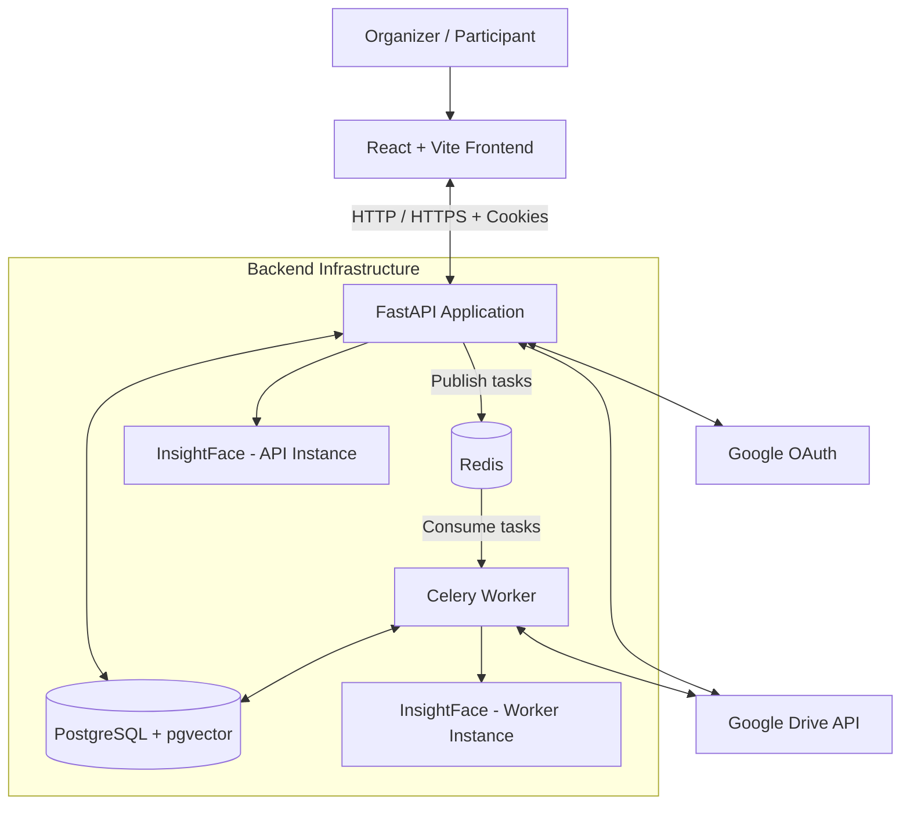
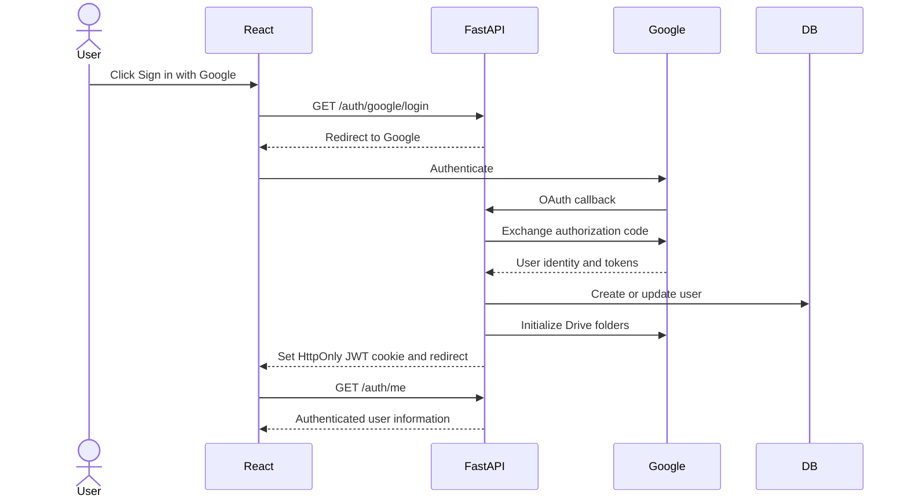
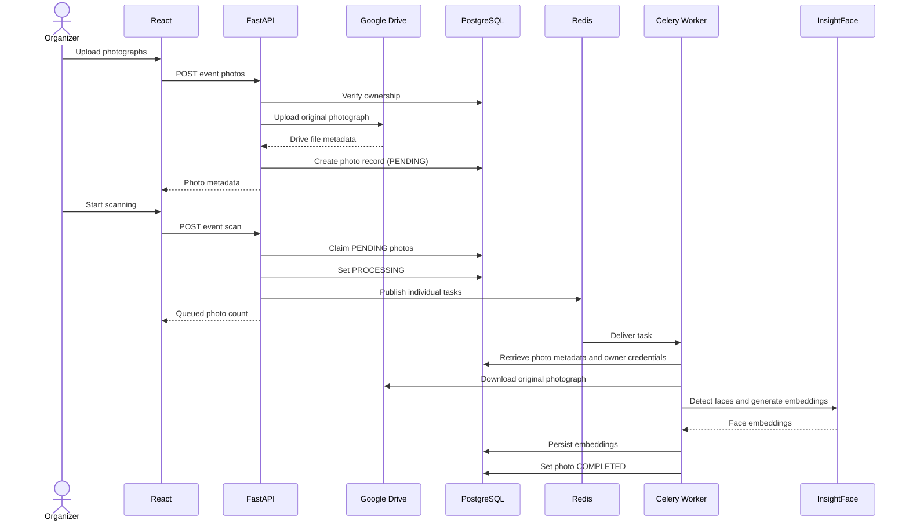
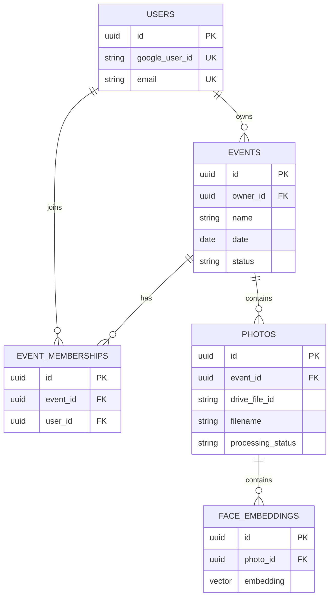
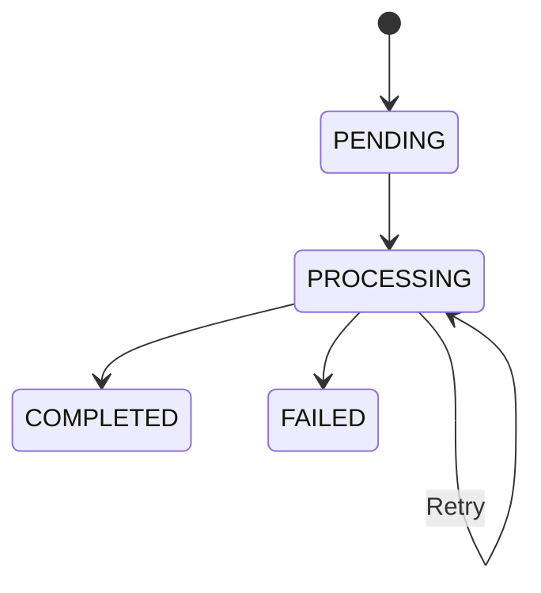
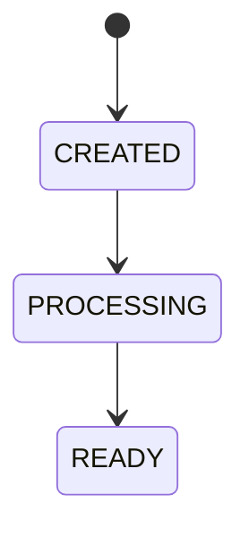

# FrameFind — System Architecture

**Project:** FrameFind  
**Stage:** Stage 1 — MVP  
**Architecture status:** Initial draft based on existing PRD  
**Implementation verification:** Pending source-code audit

## 1. Architecture Overview

FrameFind follows a client-server architecture with asynchronous background processing.

The React frontend communicates with a FastAPI backend through HTTP APIs. FastAPI handles user-facing operations, authentication, authorization, event management, photo uploads and selfie searches.

PostgreSQL stores application data and facial embeddings. Celery workers handle computationally intensive photo-processing operations asynchronously, using Redis as the message broker.

Google Drive stores original event photographs, while Google OAuth provides user authentication.

## 2. System Components

### 2.1 Frontend

**Technology:** React + Vite + JavaScript

Responsibilities:

- Provide the Event Owner Experience.
- Provide the Participant Experience.
- Handle user interactions and form validation.
- Communicate with FastAPI endpoints.
- Maintain authentication through HttpOnly cookies.
- Display event information and photo-processing status.
- Display selfie search results.
- Display authorized photographs.

The frontend must never receive Google access tokens, refresh tokens or internal Google Drive file IDs.

### 2.2 Backend API

**Technology:** FastAPI

Responsibilities:

- Handle HTTP requests.
- Manage Google OAuth authentication.
- Issue and validate FrameFind JWT cookies.
- Authenticate users.
- Enforce event ownership and membership permissions.
- Create and retrieve events.
- Handle event photo uploads.
- Manage invitation links and event membership.
- Initiate photo-processing tasks.
- Handle selfie-based searches.
- Retrieve original photographs from Google Drive.
- Coordinate database operations.

The API exposes versioned endpoints under `/api/v1`.

### 2.3 Database

**Technology:** PostgreSQL + pgvector

Responsibilities:

- Store user information.
- Store event information.
- Store event memberships.
- Store photo metadata.
- Store facial embeddings.
- Track photo-processing statuses.
- Perform event-scoped vector similarity searches.

The database is the source of truth for FrameFind application data.

### 2.4 Background Processing

**Technology:** Celery + Redis

Redis acts as the Celery message broker and result backend.

Celery workers handle:

- Retrieving original photographs from Google Drive.
- Decoding image files.
- Detecting faces.
- Generating facial embeddings.
- Persisting embeddings.
- Updating photo-processing statuses.
- Retrying failed processing tasks.

Photo processing is performed asynchronously rather than inside the upload HTTP request.

### 2.5 Face Recognition

**Technology:** InsightFace `buffalo_l`

Model components:

- SCRFD for face detection.
- ArcFace for face embedding generation.
- ONNX Runtime for CPU inference.

Each detected face receives an individual 512-dimensional embedding.

There are two processing contexts:

1. **API process:** Generates embeddings from participant selfies.
2. **Celery worker:** Generates embeddings from event photographs.

Each process maintains its own face-recognition model instance.

### 2.6 External Services

**Google OAuth**

- Authenticates users through Google.
- Provides Google identity information.
- Supplies authorization credentials for Drive operations.

**Google Drive API**

- Creates the FrameFind folder structure.
- Stores original event photographs.
- Retrieves original photographs for processing.
- Provides original photographs for authorized viewing.

Google Drive remains the original photograph storage system.

## 3. High-Level Architecture Diagram



## 4. Core Data Flows

### 4.1 Authentication Flow



FrameFind maintains its own application authentication using a JWT stored in an HttpOnly cookie.

Google OAuth tokens remain server-side.

### 4.2 Photo Upload and Processing Flow



If processing fails, Celery retries according to the configured retry policy. After retry exhaustion, the photograph is marked `FAILED`.

### 4.3 Selfie Search Flow

```mermaid
sequenceDiagram
    actor Participant
    participant React
    participant API as FastAPI
    participant Model as InsightFace
    participant DB as PostgreSQL + pgvector

    Participant->>React: Upload selfie
    React->>API: POST event search
    API->>DB: Verify event access and readiness
    API->>API: Validate selfie size
    API->>Model: Detect face and generate embedding
    Model-->>API: 512-dimensional embedding
    API->>DB: Event-scoped cosine similarity query
    DB-->>API: Matching face records
    API->>API: Filter, deduplicate and order photos
    API-->>React: Matching photo metadata
```

The selfie is processed temporarily. Its query embedding is not stored as a permanent user record.

### 4.4 Photo Viewing Flow

```mermaid
sequenceDiagram
    actor Participant
    participant React
    participant API as FastAPI
    participant DB as PostgreSQL
    participant Drive as Google Drive

    Participant->>React: Open matching photograph
    React->>API: GET /api/v1/photos/{photo_id}
    API->>DB: Retrieve photo and event
    API->>DB: Verify event ownership or membership
    API->>Drive: Retrieve original photograph
    Drive-->>API: Image data
    API-->>React: Stream authorized image
```

**Implementation status:** Photo viewing is currently a stub. This flow represents the intended implementation.

## 5. Database Architecture

PostgreSQL contains the following application entities:

| Entity | Responsibility |
|---|---|
| users | User identity and Google Drive credentials |
| events | Event information and ownership |
| event_memberships | Participant membership |
| photos | Original photograph metadata and processing status |
| face_embeddings | Individual face embeddings associated with photographs |

### Entity relationships



### Important database constraints

- `users.google_user_id` is unique.
- `users.email` is unique.
- `events.invitation_token` is unique.
- `event_memberships(event_id, user_id)` has a unique constraint.
- Each photo belongs to an event.
- Each face embedding belongs to a photo.
- Each photo can contain multiple face embeddings.

### Vector storage

Face embeddings use `VECTOR(512)` through pgvector.

Cosine distance is used for similarity search.

No vector index has been configured yet. Index selection should follow actual workload measurements.

## 6. Authentication and Authorization

### Authentication

- Google OAuth establishes user identity.
- FrameFind issues its own JWT.
- JWT is stored in an HttpOnly cookie.
- The browser cannot directly access the JWT.
- Google OAuth tokens remain server-side.

### Authorization

An event is accessible to:

1. Its owner.
2. Users with a corresponding `event_memberships` record.

The owner is represented through `events.owner_id`, not a membership record.

Event-specific operations must verify ownership or membership as appropriate.

Knowing an event UUID, photo UUID, invitation token or Drive file ID must not independently grant access.

### Security requirements

- Configure credential-aware CORS.
- Implement CSRF protection for state-changing cookie-authenticated requests.
- Validate uploaded file size and content type.
- Never expose Google credentials.
- Remove internal Drive identifiers from public API responses.
- Avoid logging sensitive credentials or image data.
- Verify authorization before retrieving original photographs.

## 7. Background Processing and Reliability

### Task execution

The scan endpoint:

1. Selects eligible pending photographs.
2. Claims records using row-level locking and `SKIP LOCKED`.
3. Changes their status to `PROCESSING`.
4. Commits the database transaction.
5. Dispatches one Celery task per photograph.

### Retry policy

- Maximum retries: 2.
- First retry delay: 30 seconds.
- Second retry delay: 120 seconds.
- Final failure: Mark photograph as `FAILED`.

### Known reliability gaps

- No transactional outbox.
- No stale task detection.
- No abandoned task recovery.
- No manual retry interface for failed photographs.

These limitations should be addressed according to MVP reliability requirements.

## 8. Photo and Event Lifecycle

### Photo processing states



A photo with no detectable faces can still reach `COMPLETED` with zero embeddings.

### Event states



The `READY` transition is part of the intended lifecycle but has not yet been implemented.

An event should become searchable after its initial processing batch has finished, even when some photographs have failed.

## 9. Application Communication

### Frontend to backend

- HTTP API communication.
- JSON request and response bodies where appropriate.
- Multipart form uploads for photographs and selfies.
- HttpOnly cookie-based authentication.
- Credential-aware browser requests.

### Backend to database

The documented architecture uses:

- Async SQLAlchemy with asyncpg for API operations.
- Synchronous SQLAlchemy with psycopg for Celery worker operations.

### Backend to background workers

- FastAPI publishes Celery tasks.
- Redis transports tasks.
- Celery workers consume and execute tasks.

### Backend to Google Drive

The backend uses Google Drive API credentials associated with the event owner to access original photographs.

## 10. Deployment Architecture

The logical application deployment requires the following runtime components:

| Component | Runtime responsibility |
|---|---|
| React frontend | Serve the frontend application |
| FastAPI | Serve HTTP APIs |
| PostgreSQL | Persist application data and embeddings |
| Redis | Broker and Celery result backend |
| Celery worker | Execute photo-processing tasks |

External dependencies:

- Google OAuth.
- Google Drive API.

The API and Celery worker are separate execution processes. The frontend communicates with FastAPI, not directly with PostgreSQL, Redis or Google Drive.

Specific hosting providers, network topology, reverse proxy configuration and production infrastructure remain deployment decisions.

## 11. Known Architecture Gaps

The following are documented gaps in the current implementation:

1. Event readiness transition is missing.
2. Photo streaming is a stub.
3. Event deletion is a stub.
4. Photo deletion is a stub.
5. API-side Google token refresh is incomplete.
6. Drive reconnection is not implemented.
7. CORS is not configured.
8. CSRF protection is missing.
9. Upload limits and content validation are incomplete.
10. Transactional outbox and stale-task recovery are absent.
11. Public photo responses expose `drive_file_id`.

These gaps should be prioritized before production release.

## 12. Architecture Principles

FrameFind follows these principles:

- Keep the architecture simple and appropriate for the MVP.
- Use a modular FastAPI application rather than premature microservices.
- Keep original photographs in Google Drive.
- Use PostgreSQL as the application source of truth.
- Execute computationally intensive photo processing asynchronously.
- Keep authentication and authorization on the backend.
- Maintain event-level data isolation.
- Avoid unnecessary infrastructure.
- Introduce additional complexity only when justified by measurable requirements.

## 13. Open Architecture Decisions

The following decisions require further validation:

- Transactional outbox versus simpler task recovery.
- Stale processing task detection and recovery strategy.
- pgvector index selection based on search workload.
- Google Drive reconnection and token refresh design.
- Production deployment topology.
- Image streaming and caching strategy.

---

**Document status:** Initial architecture draft.

**Source:** FrameFind Stage 1 PRD and frontend design decisions.

**Next step:** Verify this architecture against the actual backend source code and approve the architecture before finalizing it.